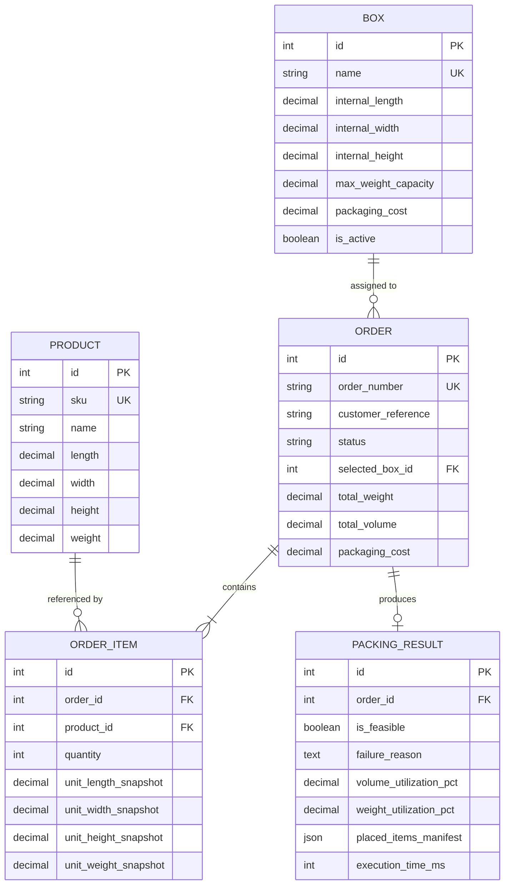

# PackSmart – Intelligent Warehouse Box Selection Engine

An enterprise Django application designed for fulfillment logistics that determines the **lowest-cost feasible shipping box** for multi-item customer orders.

PackSmart incorporates a **3D Extreme Points Bin Packing Algorithm** with **6-axis orthogonal rotations**, physical collision detection, strict weight capacity constraints, and deterministic tie-breaking.

---

## 1. Problem Statement

Fulfillment warehouses process thousands of multi-item orders daily. Assigning shipping boxes manually or relying on naive volumetric approximations causes two primary issues:
1. **False Positives (Oversimplified Volume Fit):** Two products may have combined volume smaller than a box, but their physical shapes cannot physically fit together without collision or wall penetration.
2. **Excess Packaging Costs & Dimensional Weight Surcharges:** Selecting an oversized box increases unit material cost and triggers dimensional weight surcharges from couriers (FedEx, UPS, DHL).

Warehouses require an automated, deterministic packaging engine that:
- Accurately checks whether items fit together in 3D space.
- Recommends the lowest-cost available container.
- Explains why non-selected containers were rejected.

---

## 2. Solution Overview

PackSmart addresses this challenge with a multi-tiered evaluation pipeline:
- **Fast-fail pre-filtering ($O(1)$ / $O(N)$):** Immediately disqualifies boxes that fail gross weight, gross volume, or individual item bounding constraints.
- **Cost-ascending candidate evaluation:** Evaluates viable boxes in order of increasing packaging cost. The first box that accommodates the entire order is guaranteed to be the lowest-cost solution.
- **3D Extreme Points Heuristic:** Simulates actual spatial placement using Best-Fit Decreasing (BFD) item ordering, generating valid coordinate points $(X, Y, Z)$ and testing all six orthogonal rotations.
- **Deterministic Tie-Breaking:** If two boxes have identical packaging cost, the engine chooses the container with smaller internal volume (minimizing void fill), followed by higher weight capacity, and finally lower box ID.

---

## 3. Key Features

- **3D Bin Packing Engine:** Pure Python domain service decoupled from the database, supporting full axis rotations and collision-free coordinate packing.
- **Strict Capacity Constraints:** Enforces both dimensional boundaries and maximum weight capacities.
- **Interactive Warehouse Simulator:** Web console allowing operators to assemble line items, trigger recommendation, and preview 3D arrangements.
- **Interactive 3D Isometric Canvas:** Visualizes packed item arrangements within the box wireframe directly in the browser.
- **Catalog Management & Integrity:** Full CRUD interfaces for Products and Shipping Boxes with referential protection (`ProtectedError`) preventing deletion of SKUs tied to historical orders.
- **Audit Logs & History:** Records full placement manifests, space utilization percentages, and execution runtimes.
- **REST API Endpoints:** JSON endpoints with standard HTTP status codes (`200`, `201`, `400`, `401`, `404`, `409`, `500`).
- **Comprehensive Automated Tests:** 109 independent unit and integration tests with 100% pass rate.

---

## 4. Technology Stack

- **Backend:** Python 3.14, Django 5.2.18
- **Database:** SQLite (local development) / PostgreSQL (production target)
- **Frontend:** HTML5, CSS3, Vanilla JavaScript (ES6+), Bootstrap 5.3, Bootstrap Icons
- **Testing:** Pytest 8.4.2, pytest-django 4.14.0
- **Configuration & Security:** `python-dotenv`, CSRF tokens, Django `json_script` template protection

---

## 5. Architecture Overview

```
┌─────────────────────────────────────────────────────────────┐
│                       Client Layer                          │
│   Bootstrap 5 UI Dashboard / Simulator / REST API Consumers │
└──────────────────────────────┬──────────────────────────────┘
                               │ HTTP / JSON / CSRF
                               ▼
┌─────────────────────────────────────────────────────────────┐
│                      Django App Layer                       │
│  apps/catalog: Product & Box Catalog, Forms, Admin, APIs    │
│  apps/orders:  Order Management, ViewSets, API Views        │
└──────────────────────────────┬──────────────────────────────┘
                               │
                               ▼
┌─────────────────────────────────────────────────────────────┐
│                   Packaging Service Layer                   │
│  apps.orders.services.PackagingService                      │
│  - Converts ORM objects to immutable ItemDTO & BoxDTO       │
│  - Filters active boxes & handles transactions              │
└──────────────────────────────┬──────────────────────────────┘
                               │ Immutable DTOs
                               ▼
┌─────────────────────────────────────────────────────────────┐
│                     Core Packing Engine                     │
│  apps.packing_engine (Pure Python, Zero DB Coupling)        │
│  - Total weight calculation (Decimal)                       │
│  - 6-axis orthogonal rotation generation                    │
│  - 3D Extreme Points coordinate placement                   │
│  - Deterministic box selector & audit logger                │
└─────────────────────────────────────────────────────────────┘
```

---

## 6. Database Schema & Relationships



### Integrity Rules
- **Snapshots:** `OrderItem` records dimensional snapshots at order creation time to protect historical records against catalog edits.
- **Protected Foreign Keys:** Products linked to existing orders cannot be deleted (`on_delete=models.PROTECT`), raising HTTP 409 Conflict.
- **Model Check Constraints:** Enforces positive dimensions ($>0$), positive weights ($>0$), non-negative box costs ($\ge 0$), and positive quantities ($\ge 1$).

---

## 7. Box Selection Algorithm Explanation

The algorithm implements a 3-stage heuristic pipeline:

### Numerical Walkthrough

Consider an order with two identical items:
- **Item:** $15.0 \times 15.0 \times 10.0\text{ cm}$, weight $1.0\text{ kg}$, quantity: $2$. Total weight = $2.0\text{ kg}$, total volume = $4,500\text{ cm}^3$.
- **Candidate Box A:** $20.0 \times 15.0 \times 15.0\text{ cm}$, max weight $5.0\text{ kg}$, cost ₹1.50, volume = $4,500\text{ cm}^3$.
- **Candidate Box B:** $30.0 \times 20.0 \times 15.0\text{ cm}$, max weight $10.0\text{ kg}$, cost ₹2.50, volume = $9,000\text{ cm}^3$.

1. **Pre-filter Check:**
   - Both boxes satisfy weight ($2.0\text{ kg} \le 5.0\text{ kg}$ and $10.0\text{ kg}$).
   - Box A has internal volume equal to items volume ($4,500\text{ cm}^3$).
2. **Spatial Packing Check on Box A (Lowest Cost):**
   - Place Item 1 at $(0, 0, 0)$ taking $15 \times 15 \times 10\text{ cm}$.
   - Remaining free spaces: along X is $5\text{ cm}$ ($20 - 15$), along Y is $0\text{ cm}$ ($15 - 15$), along Z is $5\text{ cm}$ ($15 - 10$).
   - Item 2 requires minimum dimension $10.0\text{ cm}$. Neither remaining space along X ($5\text{ cm}$) nor Z ($5\text{ cm}$) can accommodate Item 2.
   - **Result for Box A:** Infeasible due to spatial overlap.
3. **Spatial Packing Check on Box B (Next Lowest Cost):**
   - Place Item 1 at $(0, 0, 0)$.
   - Item 2 placed at $(15, 0, 0)$ occupying dimensions $15 \times 15 \times 10\text{ cm}$.
   - All items fit cleanly within Box B ($30 \times 20 \times 15\text{ cm}$).
   - **Result for Box B:** Feasible.
4. **Conclusion:** Box B is selected at ₹2.50. Box A is rejected with a documented spatial collision reason.

---

## 8. Algorithm Assumptions and Limitations

- **Orthogonal Alignment Only:** Items are packed parallel to the coordinate axes ($X, Y, Z$). Irregular angles or non-rectangular items are represented by their minimal bounding cuboid.
- **Rigid Bodies:** Items are assumed incompressible (e.g. clothing is modeled with fixed bounding dimensions).
- **Heuristic Nature:** 3D Bin Packing is NP-hard. The Extreme Points heuristic provides high packing density with low latency ($<20\text{ ms}$ for standard ecommerce orders), but is not guaranteed to find a mathematically optimal packing in pathological packing puzzles.
- **Weight Distribution:** The algorithm verifies total gross weight against max capacity, but does not calculate center-of-gravity or multi-tier load-bearing limits.

---

## 9. Installation & Setup

### Prerequisites
- Python 3.11+ (Python 3.14 supported)
- Git

### Installation Steps

1. **Clone the repository:**
   ```bash
   git clone <repository-url>
   cd boxSelection
   ```

2. **Create and activate a virtual environment:**
   ```bash
   python -m venv venv
   # On Windows:
   .\venv\Scripts\activate
   # On macOS/Linux:
   source venv/bin/activate
   ```

3. **Install dependencies:**
   ```bash
   pip install -r requirements.txt
   ```

4. **Environment Configuration:**
   Copy the example environment file:
   ```bash
   cp .env.example .env   # Or create .env
   ```
   Add the following settings to `.env`:
   ```ini
   DJANGO_SECRET_KEY=your-secure-random-secret-key-here
   DJANGO_DEBUG=True
   DJANGO_ALLOWED_HOSTS=localhost,127.0.0.1
   ```

5. **Apply Database Migrations:**
   ```bash
   python manage.py migrate
   ```

6. **Seed Sample Warehouse Data:**
   Seeds 10 realistic products and 6 standard shipping boxes:
   ```bash
   python manage.py seed_data
   ```

7. **Create Demo Administrator Account:**
   ```bash
   python manage.py create_demo_user
   ```
   - **Username:** `admin`
   - **Password:** `admin123password`

8. **Run the Development Server:**
   ```bash
   python manage.py runserver
   ```
   Open your browser at `http://127.0.0.1:8000/`.

---

## 10. Running the Automated Test Suite

Run the complete test suite using `pytest`:

```bash
pytest -v
```

To run a specific test area:

```bash
# Model Constraints
pytest tests/test_model_suite.py -v

# Pure 3D Algorithm
pytest tests/test_algorithm_suite.py -v

# REST API Contracts
pytest tests/test_api_suite.py -v

# End-to-End Service Integration
pytest tests/test_integration_suite.py -v
```

---

## 11. REST API Documentation

### Recommend Box for Order
- **Endpoint:** `POST /api/orders/<order_id>/recommend-box/`
- **Headers:** `Content-Type: application/json`, `X-CSRFToken: <token>`
- **Response `200 OK` (Feasible):**
  ```json
  {
    "order_number": "ORD-20261101-01",
    "customer_reference": "ACME Corp",
    "selection_status": "FEASIBLE",
    "total_order_weight": 0.500,
    "total_order_volume": 480.0,
    "selected_box": {
      "id": 1,
      "name": "Small Mailer Box (BX-SM)",
      "dimensions": {"length": 25.0, "width": 20.0, "height": 10.0, "unit": "cm"},
      "max_weight_capacity": 3.0,
      "packaging_cost": 1.50
    },
    "packaging_cost": 1.50,
    "volume_utilization_pct": 9.60,
    "weight_utilization_pct": 16.67,
    "explanation": "Box 'Small Mailer Box (BX-SM)' selected as the lowest-cost feasible box (₹1.50).",
    "rejected_boxes": [
      {
        "id": 2,
        "name": "Medium Standard Box (BX-MD)",
        "packaging_cost": 2.25,
        "rejection_reason": "Feasible, but higher packaging cost than selected box."
      }
    ],
    "placed_items": [
      {"sku": "ELEC-PHN-01", "x": 0.0, "y": 0.0, "z": 0.0, "dx": 16.0, "dy": 8.0, "dz": 2.0}
    ],
    "execution_time_ms": 3
  }
  ```

### Additional Endpoints
- `GET /api/products/` - List products (supports `?q=`)
- `POST /api/products/` - Create product (requires authentication)
- `GET /api/boxes/` - List shipping boxes (supports `?status=active`)
- `POST /api/orders/` - Create order with items and trigger recommendation

---

## 12. Screenshots

### 1. Operations Dashboard
*Displays live KPI cards for catalog counts, dispatch queue, active boxes, and recent fulfillment activity.*

### 2. Interactive Packaging Simulator
*Allows warehouse staff to assemble multi-product orders, toggle upright-only rotation, and view instant recommendations.*

### 3. Isometric 3D Packing Visualization
*Renders placed items with coordinate wireframes inside the selected box on an interactive HTML5 canvas.*

---

## 13. Future Improvements

1. **Multi-Box Order Splitting:** Automatically partitioning orders into two or more boxes when no single container can accommodate the complete order.
2. **Weight Distribution & Center of Gravity:** Calculating center of mass to prevent shipping boxes from tilting during transit.
3. **Barcode Scanner Integration:** Adding direct USB/Bluetooth barcode scanner input for picking stations.
4. **PostgreSQL Cube / Spatial Indexing:** Using spatial database indexing for catalog lookups on high-density inventories ($>10,000$ SKUs).
